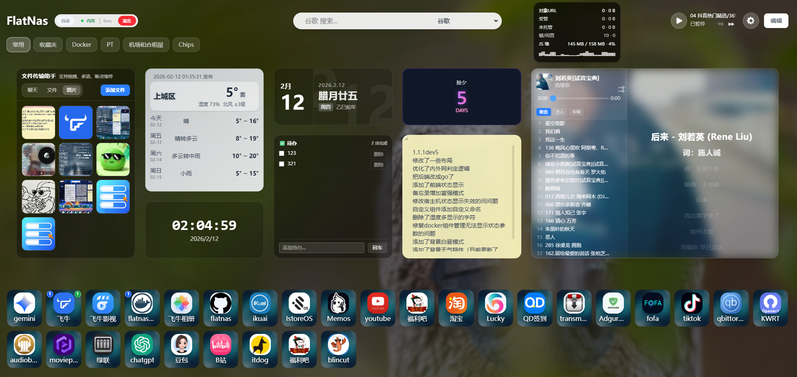

# FlatNas（自托管分支）

> 轻量级个人导航页与仪表盘：左侧书签/分组侧栏 + 顶部搜索 + 可自由拖拽的组件网格，内置 20+ 组件，
> 无数据库、纯文件存储。一个容器跑起来，就是一台 NAS 的门户首页。



本仓库是 [Garry-QD/FlatNas](https://github.com/Garry-QD/FlatNas) v1.2.6 的自托管分支（Fork），
为 **Docker / Unraid 拉取部署** 做了裁剪与容器化改造；功能逻辑、UI 布局、数据格式与上游完全一致，
上游的配置备份、自定义 CSS/JS 可直接迁移过来。上游原始说明见 [docs/README_UPSTREAM.md](docs/README_UPSTREAM.md)。

## 与上游的差异

| 项目 | 上游 | 本分支 |
| --- | --- | --- |
| 分发方式 | Docker Hub 预构建 + Debian 脚本 + Release 二进制 | 只走 Docker / GHCR 自建镜像（源码可复现） |
| 仓库体积 | 含打包产物、示例媒体、构建产物（约 235 MB） | 只留可构建源码 + 图标库（约 45 MB） |
| 镜像构建 | 推 Docker Hub | GitHub Actions → `ghcr.io/mjy378283319/flatnas`，amd64/arm64 |
| 编排文件 | 单一 compose | 通用 compose + Unraid 专用 compose + CA 模板 |
| 镜像细节 | 无健康检查 | `HEALTHCHECK`、OCI labels、显式 `PORT/HOST/BASE_DIR` |

## 功能

**布局**

- 左侧可收起侧边栏，书签树 / 分组列表双视图
- 顶部站点标题 + 多引擎搜索框（记住上次使用的引擎）
- 主体组件网格：自由拖拽、拉伸、多尺寸；桌面/平板/手机三套布局独立保存
- 分组管理：新建/排序/隐藏、分组级卡片背景（图片+模糊+遮罩）、图标形状、标题样式
- 页脚访客统计（总访问/今日/在线时长），支持自定义 HTML 页脚

**组件**

时钟、时钟+天气、简版天气、高德天气、日历、备忘录、待办、RSS 阅读器、热搜榜、书签、
音乐播放器、文件传输助手（文本/图片/大文件断点续传）、Docker 管理、
宿主机监控（CPU/内存/磁盘/网络）、iframe 嵌入、计算器、倒计时、计数、自定义 HTML/CSS 组件。

**系统能力**

- 内外网智能切换：按客户端 IP、访问域名、延迟三维判定，自动选内网/外网地址
- 多端实时同步：Socket.IO + 原生 WebSocket，带配置版本号与冲突解决弹窗
- 认证：JWT(HS256) + bcrypt，单用户（默认 `admin`/`admin`）与多用户两种模式
- 个性化：内置图标库、图标上传、壁纸库与轮换、自定义 CSS/JS（支持 `<mobile>`/`<dark>` 等增强语法）
- 7 种界面语言：简中、繁中、English、日本語、Deutsch、Français、Español
- 数据本地化：配置全在 `server/data/data.json`，支持版本快照与回滚

## 快速开始

### Docker Compose

```bash
git clone https://github.com/mjy378283319/FlatNas.git
cd FlatNas
cp .env.example .env      # 把 FLATNAS_IMAGE 改成你的镜像地址
docker compose up -d
```

打开 `http://<NAS-IP>:23000`，默认密码 `admin` —— 登录后立刻在设置里改掉。

### 直接拉镜像

```bash
docker run -d --name flatnas -p 23000:3000 \
  -v $PWD/data:/app/server/data \
  -v $PWD/music:/app/server/music \
  -v $PWD/PC:/app/server/PC \
  -v $PWD/APP:/app/server/APP \
  -v $PWD/doc:/app/server/doc \
  ghcr.io/mjy378283319/flatnas:latest
```

### Unraid

三选一，详见 [docs/DEPLOY.md](docs/DEPLOY.md#3-unraid-部署)：

1. **模板**：`Docker` → `Add Container` → 模板 URL 填 `.../unraid/flatnas.xml`
2. **Compose Manager**：新建 Stack，粘贴 `docker-compose.unraid.yml`
3. **手动**：镜像 `ghcr.io/mjy378283319/flatnas:latest`，端口 `23000:3000`，挂 5 个 appdata 目录

> GHCR 私有镜像先登录：`docker login ghcr.io -u <用户名>`，密码用 PAT（勾 `read:packages`）。

## 文档

| 文档 | 内容 |
| --- | --- |
| [docs/DEPLOY.md](docs/DEPLOY.md) | 镜像构建、GHCR 推送、Unraid 拉取配置、反代/子路径、备份升级、故障排查 |
| [docs/ARCHITECTURE.md](docs/ARCHITECTURE.md) | 技术栈、目录结构、数据模型、API、环境变量、同步机制 |
| [NOTICE](NOTICE) / [LICENSE](LICENSE) | 归属声明与 AGPLv3 原文 |

## 目录速览

```
FlatNas/
├── backend/                 Go/Gin 后端（API、WebSocket、Docker、监控、文件传输）
├── frontend/                Vue 3 + Vite 前端（组件、store、i18n、图标素材）
├── server/                  运行期数据目录（data/music/PC/APP/doc，容器挂载点）
├── unraid/                  Unraid CA 模板 + 图标
├── docs/                    部署与架构文档
├── Dockerfile               三阶段构建：前端 → 后端 → alpine 运行时
├── docker-compose.yml       通用编排
├── docker-compose.unraid.yml
└── .github/workflows/       GHCR 多架构自动构建
```

## 许可与归属

沿用上游 **GNU AGPLv3**，原始版权归 Garry-QD 及贡献者，详见 [NOTICE](NOTICE)。

AGPLv3 要求：分发修改版（包括以容器镜像对外提供网络服务）时保留许可证与版权声明，并向使用者提供
完整对应源码。本仓库即对应源码，二次分发请保持公开。

## 致谢

- 原作者：[Garry-QD/FlatNas](https://github.com/Garry-QD/FlatNas)
- 上游文档：<https://flatnas.top/>
